# Reskin trang bị Hero — Tài liệu cho đội Art

Cập nhật: 2026-10-15.
Tài liệu này tổng kết toàn bộ ảnh trang bị của hero (8 loại đồ, 241 món) để đội Art vẽ lại theo concept mới (hero vịt).
Toàn bộ ảnh gốc đã gom về một thư mục, chia theo loại đồ (mục 2).

---

## 1. Concept mới

| Hero trơn | Hero mặc đủ đồ |
|---|---|
|  |  |

- Hero là con vịt, nhìn sang trái.
- Trên người hiện 6 món: dao, mũ, áo, balo, kính, tẩu.
- Nhẫn và dây chuyền không hiện trên người, chỉ có icon trong túi đồ.

## 2. Thư mục ảnh gốc

Đường dẫn trong project Unity: `2026DungeonRushUnity/Assets/_Assets/_ResourceGame/HeroEquipment/`

| Thư mục | Nội dung | Số ảnh |
|---|---|---|
| `00_EmptySlot` | Icon ô trống khi chưa mặc đồ | 8 |
| `01_Weapon/Melee` | Vũ khí cận chiến | 30 |
| `01_Weapon/Ranged` | Vũ khí tầm xa | 29 |
| `02_Helmet` | Mũ | 40 |
| `03_Gloves` | Găng tay | 40 |
| `04_Backpack` | Balo | 20 |
| `05_Ring` | Nhẫn | 30 |
| `06_Necklace` | Dây chuyền | 30 |
| `07_Cape` | Áo choàng | 12 |
| `08_Wing` | Cánh | 10 |

Art mới đã vẽ nằm ở `2026DungeonRushUnity/Assets/_Assets/_ArtReskin/Items/` (mục 5).

## 3. Tổng quan 8 loại đồ

### 3.1. Đồ cũ đổi thành đồ mới

| Loại đồ gốc | Đồ mới | Hiện trên người |
|---|---|---|
| Weapon (vũ khí) | Dao | Có |
| Helmet (mũ) | Mũ lưỡi trai | Có |
| Gloves (găng tay) | Áo | Có |
| Backpack (balo) | Balo | Có |
| Wing (cánh) | Kính | Có |
| Cape (áo choàng) | Tẩu | Có |
| Ring (nhẫn) | Chưa có concept | Không |
| Necklace (dây chuyền) | Chưa có concept | Không |

### 3.2. Số lượng cần vẽ

| Loại đồ | Tổng số món | Số tier | Mẫu mỗi tier | Art mới đã có |
|---|---|---|---|---|
| Weapon cận chiến | 30 | 10 | 3 | 10 |
| Weapon tầm xa | 29 | 10 | 3 | 0 |
| Helmet → Mũ | 40 | 10 | 4 | 10 |
| Gloves → Áo | 40 | 10 | 4 | 10 |
| Backpack → Balo | 20 | 10 | 2 | 10 |
| Ring → Nhẫn | 30 | 10 | 3 | 0 |
| Necklace → Dây chuyền | 30 | 10 | 3 | 0 |
| Cape → Tẩu | 12 | 6 | 2 | 10 |
| Wing → Kính | 10 | 10 | 1 | 10 |
| **Tổng** | **241** | | | **60** |

- Weapon tầm xa tier 2 chỉ có 2 mẫu, các tier khác 3 mẫu.
- Cape chỉ có tier 1 đến tier 6.

## 4. Mỗi món cần những ảnh gì

### 4.1. Hai loại ảnh

| Loại ảnh | Dùng ở đâu | Món cần |
|---|---|---|
| Icon | Túi đồ, ô trang bị, popup chi tiết, rương | Cả 8 loại |
| Ảnh gắn người | Gắn lên hero trong trận và ở sảnh | 6 loại hiện trên người |

- Hiện game chưa có ảnh gắn người riêng, đang lấy luôn icon gắn lên hero.
- Code đã sẵn chỗ nhận ảnh gắn người riêng; có ảnh là game dùng, không cần sửa code.

### 4.2. Quy cách chung

- PNG nền trong suốt.
- Tâm ảnh (pivot) ở giữa ảnh.
- Tỉ lệ trong Unity: 100 pixel = 1 đơn vị.
- Ảnh gắn người vẽ cùng tỉ lệ với `Hero.png` (76 × 89 px), hướng nhìn sang trái giống hero.
- Cắt sát viền nét vẽ, không chừa khoảng trống thừa.
- Màu chủ đạo của món theo màu tier (mục 4.4), như bộ art mới đang làm.

### 4.3. Kích thước tham khảo

Kích thước icon gốc (để vừa ô UI):

| Loại đồ | Rộng (px) | Cao (px) |
|---|---|---|
| Weapon | 49–208 | 51–200 |
| Helmet | 126–192 | 93–172 |
| Gloves | 162–187 | 96–118 |
| Backpack | 122–197 | 85–149 |
| Ring | 125–161 | 132–174 |
| Necklace | 128–216 | 125–201 |
| Cape | 164–300 | 95–268 |
| Wing | 300 | 92–170 |

Kích thước ảnh art mới đã vẽ (ảnh gắn người):

| Đồ mới | Kích thước (px) |
|---|---|
| Dao | 83 × 23 |
| Mũ | 62 × 36 |
| Áo | 68 × 44 |
| Balo | 60 × 65 |
| Kính | 52 × 17 |
| Tẩu | 40 × 25 |

### 4.4. Màu nền theo tier

Ô item trong game tô nền theo tier (ảnh `_ResourceGame/BgRarity/tier_XX_background.png`).

| Tier | Độ hiếm | Màu nền |
|---|---|---|
| 1 | Common | Xám |
| 2 | Uncommon | Nâu nhạt |
| 3 | Rare | Xanh lá |
| 4 | Epic | Xanh dương |
| 5 | Legendary | Vàng |
| 6 | Mythic | Tím |
| 7 | Artifact | Xanh lá đậm |
| 8 | Ancient | Xanh navy |
| 9 | Immortal | Đỏ |
| 10 | Divine | Cam |

## 5. Art mới đã có

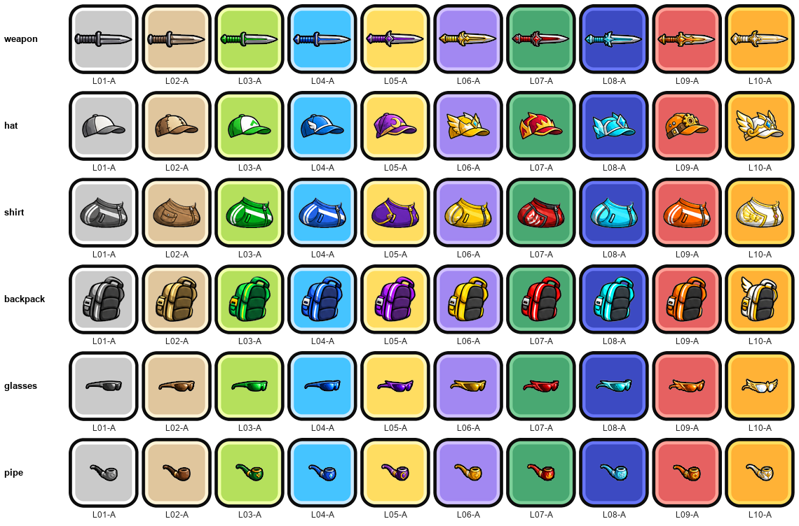

- 6 loại × 10 tier, mỗi tier 1 mẫu (đuôi `-A`).
- Đặt tên `<loại>-L<tier 2 số>-<mẫu>`, ví dụ `hats-L03-A` = mũ tier 3 mẫu A.
- Các mẫu còn thiếu đặt tên tiếp `-B`, `-C`, `-D` (bảng phụ lục có sẵn cột "Tên file mới" cho từng món).

## 6. Ảnh gốc từng loại

Mỗi hàng là một tier, mỗi cột là một mẫu. Chữ dưới ô là mã món trong game.

### 6.1. Weapon cận chiến → Dao

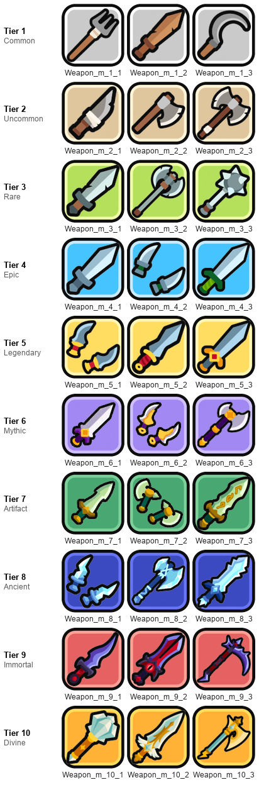

- 3 mẫu mỗi tier: kiếm, rìu, dao găm, chuỳ, lưỡi hái…
- Art mới hiện có 1 mẫu dao mỗi tier.

### 6.2. Weapon tầm xa

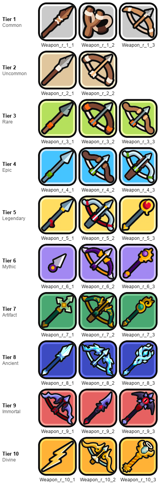

- 3 mẫu mỗi tier: cung, nỏ, lao, gậy phép…
- Chưa có concept mới (mục 8).

### 6.3. Helmet → Mũ

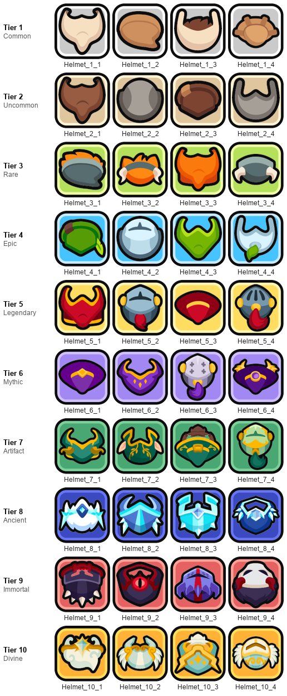

- 4 mẫu mỗi tier.

### 6.4. Gloves → Áo

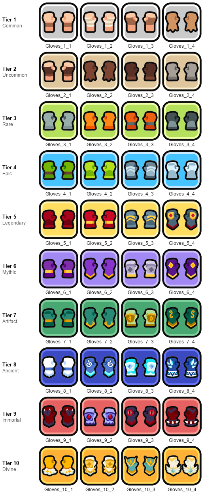

- 4 mẫu mỗi tier.
- Trên hero, món này thay ảnh phần tay/áo; cởi ra thì hero trở về ảnh tay mặc định.

### 6.5. Backpack → Balo

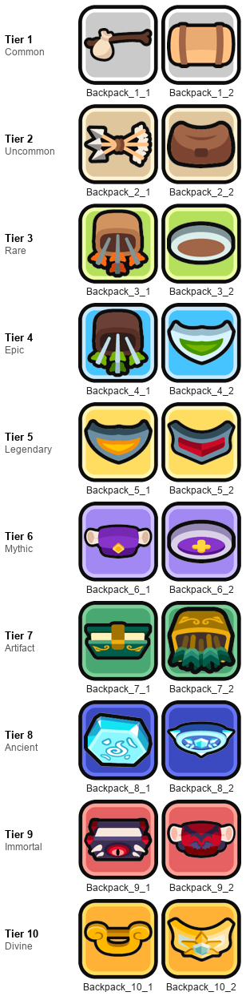

- 2 mẫu mỗi tier.

### 6.6. Ring → Nhẫn

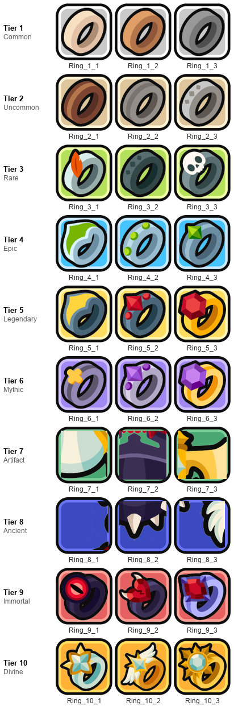

- 3 mẫu mỗi tier.
- Chỉ cần icon.

### 6.7. Necklace → Dây chuyền

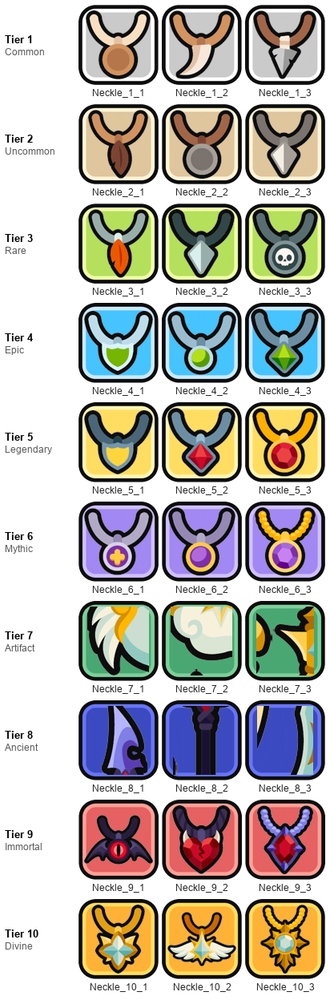

- 3 mẫu mỗi tier.
- Chỉ cần icon.

### 6.8. Cape → Tẩu

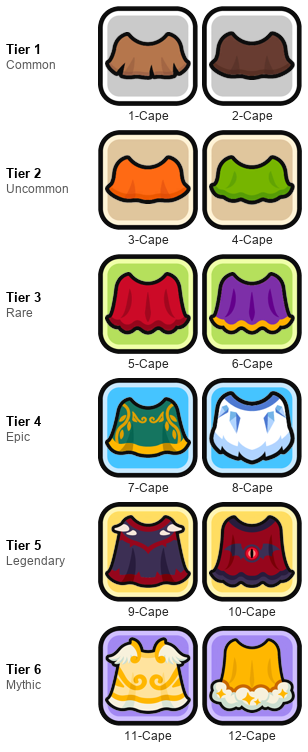

- 2 mẫu mỗi tier, chỉ tier 1 đến 6 (12 món).
- Có nút "Show Cloak" trong game để ẩn món này trên người.

### 6.9. Wing → Kính

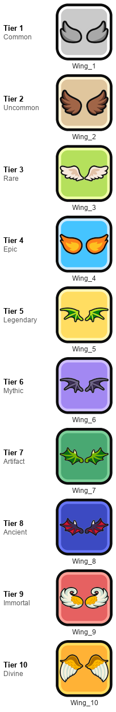

- 1 mẫu mỗi tier.
- Art mới đã đủ 10 kính.

### 6.10. Icon ô trống

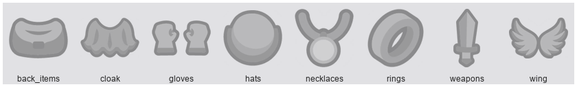

- 8 icon hình bóng mờ hiện khi ô trang bị chưa mặc đồ.
- Cần vẽ lại theo đồ mới: dao, mũ, áo, balo, nhẫn, dây chuyền, tẩu, kính.

## 7. Bàn giao

1. Mỗi món giao 1 icon và (với 6 loại hiện trên người) 1 ảnh gắn người.
2. Đặt tên theo cột "Tên file mới" trong phụ lục; ảnh gắn người thêm đuôi `_body`, ví dụ `hats-L03-B_body.png`.
3. Chia thư mục theo loại đồ giống `_ArtReskin/Items/` hiện tại.
4. Dev gán ảnh vào data của từng món.

## 8. Chưa chốt

### 8.1. Chờ quyết định

- Weapon tầm xa (cung, nỏ, gậy phép) đổi thành gì trong concept vịt, hay bỏ hẳn hệ tầm xa.
- Nhẫn và dây chuyền giữ nguyên hay đổi sang đồ khác.
- Tẩu (Cape) gốc chỉ có 12 món, tier 1 đến 6; art đã vẽ 10 tẩu tier 1 đến 10 — giữ 6 tier như gốc hay mở rộng Cape lên 10 tier.
- Icon và ảnh gắn người dùng chung 1 ảnh (như hiện tại) hay tách riêng.

## Phụ lục — Danh sách từng món

Cột "File ảnh gốc" là tên file trong thư mục `HeroEquipment/` (mục 2).
Cột "Tên file mới" là tên đề xuất cho art mới, theo cách đặt tên art đang dùng.

### A1. Vũ khí cận chiến (Melee) — 30 món

| Tier | Độ hiếm | Mã | Tên trong game | File ảnh gốc | Tên file mới |
|---|---|---|---|---|---|
| 1 | Common | Weapon_m_1_1 | Pitchfork | Weapon_m_1_1.png | weapons-L01-A |
| 1 | Common | Weapon_m_1_2 | Wooden Sword | Weapon_m_1_2.png | weapons-L01-B |
| 1 | Common | Weapon_m_1_3 | Sickle | Weapon_m_1_3.png | weapons-L01-C |
| 2 | Uncommon | Weapon_m_2_1 | Crude Dagger | Weapon_m_2_1.png | weapons-L02-A |
| 2 | Uncommon | Weapon_m_2_2 | Wood Axe | Weapon_m_2_2.png | weapons-L02-B |
| 2 | Uncommon | Weapon_m_2_3 | Battle Axe | Weapon_m_2_3.png | weapons-L02-C |
| 3 | Rare | Weapon_m_3_1 | Iron Sword | Weapon_m_3_1.png | weapons-L03-A |
| 3 | Rare | Weapon_m_3_2 | Great Axe | Weapon_m_3_2.png | weapons-L03-B |
| 3 | Rare | Weapon_m_3_3 | Mace | Weapon_m_3_3.png | weapons-L03-C |
| 4 | Epic | Weapon_m_4_1 | Soldier Sword | Weapon_m_4_1.png | weapons-L04-A |
| 4 | Epic | Weapon_m_4_2 | Soldier Daggers | Weapon_m_4_2.png | weapons-L04-B |
| 4 | Epic | Weapon_m_4_3 | Squire Sword | Weapon_m_4_3.png | weapons-L04-C |
| 5 | Legendary | Weapon_m_5_1 | Twin Dagger | Weapon_m_5_1.png | weapons-L05-A |
| 5 | Legendary | Weapon_m_5_2 | Royal Sword | Weapon_m_5_2.png | weapons-L05-B |
| 5 | Legendary | Weapon_m_5_3 | Knight Sword | Weapon_m_5_3.png | weapons-L05-C |
| 6 | Mythic | Weapon_m_6_1 | Mystic Sword | Weapon_m_6_1.png | weapons-L06-A |
| 6 | Mythic | Weapon_m_6_2 | Arcane Dagger | Weapon_m_6_2.png | weapons-L06-B |
| 6 | Mythic | Weapon_m_6_3 | Glimmer Axe | Weapon_m_6_3.png | weapons-L06-C |
| 7 | Artifact | Weapon_m_7_1 | Sacred Sword | Weapon_m_7_1.png | weapons-L07-A |
| 7 | Artifact | Weapon_m_7_2 | Wild Axe | Weapon_m_7_2.png | weapons-L07-B |
| 7 | Artifact | Weapon_m_7_3 | Druidic Sword | Weapon_m_7_3.png | weapons-L07-C |
| 8 | Ancient | Weapon_m_8_1 | Ice Dagger | Weapon_m_8_1.png | weapons-L08-A |
| 8 | Ancient | Weapon_m_8_2 | Frost Greataxe | Weapon_m_8_2.png | weapons-L08-B |
| 8 | Ancient | Weapon_m_8_3 | Blizzard Greatsword | Weapon_m_8_3.png | weapons-L08-C |
| 9 | Immortal | Weapon_m_9_1 | Dread Dagger | Weapon_m_9_1.png | weapons-L09-A |
| 9 | Immortal | Weapon_m_9_2 | Infernal Greatsword | Weapon_m_9_2.png | weapons-L09-B |
| 9 | Immortal | Weapon_m_9_3 | Void Scythe | Weapon_m_9_3.png | weapons-L09-C |
| 10 | Divine | Weapon_m_10_1 | Divine Mace | Weapon_m_10_1.png | weapons-L10-A |
| 10 | Divine | Weapon_m_10_2 | Holy Greatsword | Weapon_m_10_2.png | weapons-L10-B |
| 10 | Divine | Weapon_m_10_3 | Solar Greataxe | Weapon_m_10_3.png | weapons-L10-C |

### A2. Vũ khí tầm xa (Ranged) — 29 món

| Tier | Độ hiếm | Mã | Tên trong game | File ảnh gốc | Tên file mới |
|---|---|---|---|---|---|
| 1 | Common | Weapon_r_1_1 | Sling | Weapon_r_1_1.png | weapons-ranged-L01-A |
| 1 | Common | Weapon_r_1_2 | Throwing Stick | Weapon_r_1_2.png | weapons-ranged-L01-B |
| 1 | Common | Weapon_r_1_3 | Primitive Bow | Weapon_r_1_3.png | weapons-ranged-L01-C |
| 2 | Uncommon | Weapon_r_2_1 | Javelin | Weapon_r_2_1.png | weapons-ranged-L02-A |
| 2 | Uncommon | Weapon_r_2_2 | Bow | Weapon_r_2_2.png | weapons-ranged-L02-B |
| 3 | Rare | Weapon_r_3_1 | Viking Spear | Weapon_r_3_1.png | weapons-ranged-L03-A |
| 3 | Rare | Weapon_r_3_2 | Viking Bow | Weapon_r_3_2.png | weapons-ranged-L03-B |
| 3 | Rare | Weapon_r_3_3 | Longbow | Weapon_r_3_3.png | weapons-ranged-L03-C |
| 4 | Epic | Weapon_r_4_1 | Squire Javelin | Weapon_r_4_1.png | weapons-ranged-L04-A |
| 4 | Epic | Weapon_r_4_2 | Soldier Bow | Weapon_r_4_2.png | weapons-ranged-L04-B |
| 4 | Epic | Weapon_r_4_3 | Squire Crossbow | Weapon_r_4_3.png | weapons-ranged-L04-C |
| 5 | Legendary | Weapon_r_5_1 | Knight Javelin | Weapon_r_5_1.png | weapons-ranged-L05-A |
| 5 | Legendary | Weapon_r_5_2 | Knight Crossbow | Weapon_r_5_2.png | weapons-ranged-L05-B |
| 5 | Legendary | Weapon_r_5_3 | Flame Staff | Weapon_r_5_3.png | weapons-ranged-L05-C |
| 6 | Mythic | Weapon_r_6_1 | Mystic Kunai | Weapon_r_6_1.png | weapons-ranged-L06-A |
| 6 | Mythic | Weapon_r_6_2 | Arcane Bow | Weapon_r_6_2.png | weapons-ranged-L06-B |
| 6 | Mythic | Weapon_r_6_3 | Wizard Staff | Weapon_r_6_3.png | weapons-ranged-L06-C |
| 7 | Artifact | Weapon_r_7_1 | Sacred Spear | Weapon_r_7_1.png | weapons-ranged-L07-A |
| 7 | Artifact | Weapon_r_7_2 | Druidic Crossbow | Weapon_r_7_2.png | weapons-ranged-L07-B |
| 7 | Artifact | Weapon_r_7_3 | Wild Staff | Weapon_r_7_3.png | weapons-ranged-L07-C |
| 8 | Ancient | Weapon_r_8_1 | Ice Javelin | Weapon_r_8_1.png | weapons-ranged-L08-A |
| 8 | Ancient | Weapon_r_8_2 | Frost Bow | Weapon_r_8_2.png | weapons-ranged-L08-B |
| 8 | Ancient | Weapon_r_8_3 | Ice Staff | Weapon_r_8_3.png | weapons-ranged-L08-C |
| 9 | Immortal | Weapon_r_9_1 | Undying Bow | Weapon_r_9_1.png | weapons-ranged-L09-A |
| 9 | Immortal | Weapon_r_9_2 | Void Javelin | Weapon_r_9_2.png | weapons-ranged-L09-B |
| 9 | Immortal | Weapon_r_9_3 | Tyrant Staff | Weapon_r_9_3.png | weapons-ranged-L09-C |
| 10 | Divine | Weapon_r_10_1 | Celestial Lightning | Weapon_r_10_1.png | weapons-ranged-L10-A |
| 10 | Divine | Weapon_r_10_2 | Eternal Crossbow | Weapon_r_10_2.png | weapons-ranged-L10-B |
| 10 | Divine | Weapon_r_10_3 | Radiant Staff | Weapon_r_10_3.png | weapons-ranged-L10-C |

### A3. Mũ (Helmet) — 40 món

| Tier | Độ hiếm | Mã | Tên trong game | File ảnh gốc | Tên file mới |
|---|---|---|---|---|---|
| 1 | Common | Helmet_1_1 | Peasant Cape | Helmet_1_1.png | hats-L01-A |
| 1 | Common | Helmet_1_2 | Peasant Cap | Helmet_1_2.png | hats-L01-B |
| 1 | Common | Helmet_1_3 | 'Peasant Hat ' | Helmet_1_3.png | hats-L01-C |
| 1 | Common | Helmet_1_4 | Straw Hat | Helmet_1_4.png | hats-L01-D |
| 2 | Uncommon | Helmet_2_1 | Leather Cape | Helmet_2_1.png | hats-L02-A |
| 2 | Uncommon | Helmet_2_2 | Round Helmet | Helmet_2_2.png | hats-L02-B |
| 2 | Uncommon | Helmet_2_3 | Marksman Hat | Helmet_2_3.png | hats-L02-C |
| 2 | Uncommon | Helmet_2_4 | Simple Helmet | Helmet_2_4.png | hats-L02-D |
| 3 | Rare | Helmet_3_1 | Viking Hat | Helmet_3_1.png | hats-L03-A |
| 3 | Rare | Helmet_3_2 | Viking Horns | Helmet_3_2.png | hats-L03-B |
| 3 | Rare | Helmet_3_3 | Viking Cape | Helmet_3_3.png | hats-L03-C |
| 3 | Rare | Helmet_3_4 | Viking Helmet | Helmet_3_4.png | hats-L03-D |
| 4 | Epic | Helmet_4_1 | Archer Hat | Helmet_4_1.png | hats-L04-A |
| 4 | Epic | Helmet_4_2 | Squire Helmet | Helmet_4_2.png | hats-L04-B |
| 4 | Epic | Helmet_4_3 | Archer Cape | Helmet_4_3.png | hats-L04-C |
| 4 | Epic | Helmet_4_4 | Soldier Helmet | Helmet_4_4.png | hats-L04-D |
| 5 | Legendary | Helmet_5_1 | Royal Cape | Helmet_5_1.png | hats-L05-A |
| 5 | Legendary | Helmet_5_2 | Knight Helmet | Helmet_5_2.png | hats-L05-B |
| 5 | Legendary | Helmet_5_3 | Wizard Hat | Helmet_5_3.png | hats-L05-C |
| 5 | Legendary | Helmet_5_4 | Templar Helmet | Helmet_5_4.png | hats-L05-D |
| 6 | Mythic | Helmet_6_1 | Mage Hat | Helmet_6_1.png | hats-L06-A |
| 6 | Mythic | Helmet_6_2 | Sorcerer Cape | Helmet_6_2.png | hats-L06-B |
| 6 | Mythic | Helmet_6_3 | Arcane Helmet | Helmet_6_3.png | hats-L06-C |
| 6 | Mythic | Helmet_6_4 | Wizard Hat | Helmet_6_4.png | hats-L06-D |
| 7 | Artifact | Helmet_7_1 | Druidic Cape | Helmet_7_1.png | hats-L07-A |
| 7 | Artifact | Helmet_7_2 | Elven Helmet | Helmet_7_2.png | hats-L07-B |
| 7 | Artifact | Helmet_7_3 | Druid Hat | Helmet_7_3.png | hats-L07-C |
| 7 | Artifact | Helmet_7_4 | Verdant Helmet | Helmet_7_4.png | hats-L07-D |
| 8 | Ancient | Helmet_8_1 | Glacial Tiara | Helmet_8_1.png | hats-L08-A |
| 8 | Ancient | Helmet_8_2 | Frost Helmet | Helmet_8_2.png | hats-L08-B |
| 8 | Ancient | Helmet_8_3 | Ice Helmet | Helmet_8_3.png | hats-L08-C |
| 8 | Ancient | Helmet_8_4 | Chill Cape | Helmet_8_4.png | hats-L08-D |
| 9 | Immortal | Helmet_9_1 | Dread Helm | Helmet_9_1.png | hats-L09-A |
| 9 | Immortal | Helmet_9_2 | Infernal Cape | Helmet_9_2.png | hats-L09-B |
| 9 | Immortal | Helmet_9_3 | Tyrant Helmet | Helmet_9_3.png | hats-L09-C |
| 9 | Immortal | Helmet_9_4 | Undying Mask | Helmet_9_4.png | hats-L09-D |
| 10 | Divine | Helmet_10_1 | Blessed Tiara | Helmet_10_1.png | hats-L10-A |
| 10 | Divine | Helmet_10_2 | Celestial Helmet | Helmet_10_2.png | hats-L10-B |
| 10 | Divine | Helmet_10_3 | Eternal Cape | Helmet_10_3.png | hats-L10-C |
| 10 | Divine | Helmet_10_4 | Solar Helmet | Helmet_10_4.png | hats-L10-D |

### A4. Găng tay (Gloves) — 40 món

| Tier | Độ hiếm | Mã | Tên trong game | File ảnh gốc | Tên file mới |
|---|---|---|---|---|---|
| 1 | Common | Gloves_1_1 | Hide Bracers | Gloves_1_1.png | shirts-L01-A |
| 1 | Common | Gloves_1_2 | Hand Wraps | Gloves_1_2.png | shirts-L01-B |
| 1 | Common | Gloves_1_3 | Hide Gloves | Gloves_1_3.png | shirts-L01-C |
| 1 | Common | Gloves_1_4 | Leather Gloves | Gloves_1_4.png | shirts-L01-D |
| 2 | Uncommon | Gloves_2_1 | Vagabond Gloves | Gloves_2_1.png | shirts-L02-A |
| 2 | Uncommon | Gloves_2_2 | Farm Gloves | Gloves_2_2.png | shirts-L02-B |
| 2 | Uncommon | Gloves_2_3 | Rider Gloves | Gloves_2_3.png | shirts-L02-C |
| 2 | Uncommon | Gloves_2_4 | Iron Gloves | Gloves_2_4.png | shirts-L02-D |
| 3 | Rare | Gloves_3_1 | Steel Gloves | Gloves_3_1.png | shirts-L03-A |
| 3 | Rare | Gloves_3_2 | Orange Gloves | Gloves_3_2.png | shirts-L03-B |
| 3 | Rare | Gloves_3_3 | Orange Mittens | Gloves_3_3.png | shirts-L03-C |
| 3 | Rare | Gloves_3_4 | Iron Gauntlets | Gloves_3_4.png | shirts-L03-D |
| 4 | Epic | Gloves_4_1 | Archer Gloves | Gloves_4_1.png | shirts-L04-A |
| 4 | Epic | Gloves_4_2 | Archer Mittens | Gloves_4_2.png | shirts-L04-B |
| 4 | Epic | Gloves_4_3 | Heavy Gloves | Gloves_4_3.png | shirts-L04-C |
| 4 | Epic | Gloves_4_4 | Heavy Gauntlets | Gloves_4_4.png | shirts-L04-D |
| 5 | Legendary | Gloves_5_1 | Crimson Gloves | Gloves_5_1.png | shirts-L05-A |
| 5 | Legendary | Gloves_5_2 | Crimson Gauntlets | Gloves_5_2.png | shirts-L05-B |
| 5 | Legendary | Gloves_5_3 | Knight Gloves | Gloves_5_3.png | shirts-L05-C |
| 5 | Legendary | Gloves_5_4 | Templar Gloves | Gloves_5_4.png | shirts-L05-D |
| 6 | Mythic | Gloves_6_1 | Mystic Gloves | Gloves_6_1.png | shirts-L06-A |
| 6 | Mythic | Gloves_6_2 | Mage Gloves | Gloves_6_2.png | shirts-L06-B |
| 6 | Mythic | Gloves_6_3 | Arcane Gloves | Gloves_6_3.png | shirts-L06-C |
| 6 | Mythic | Gloves_6_4 | Crystal Gloves | Gloves_6_4.png | shirts-L06-D |
| 7 | Artifact | Gloves_7_1 | Wild Gloves | Gloves_7_1.png | shirts-L07-A |
| 7 | Artifact | Gloves_7_2 | Druidic Gloves | Gloves_7_2.png | shirts-L07-B |
| 7 | Artifact | Gloves_7_3 | Sacred Gloves | Gloves_7_3.png | shirts-L07-C |
| 7 | Artifact | Gloves_7_4 | Verdant Gloves | Gloves_7_4.png | shirts-L07-D |
| 8 | Ancient | Gloves_8_1 | Winter Gloves | Gloves_8_1.png | shirts-L08-A |
| 8 | Ancient | Gloves_8_2 | Frost Gloves | Gloves_8_2.png | shirts-L08-B |
| 8 | Ancient | Gloves_8_3 | Chill Gloves | Gloves_8_3.png | shirts-L08-C |
| 8 | Ancient | Gloves_8_4 | Ice Gloves | Gloves_8_4.png | shirts-L08-D |
| 9 | Immortal | Gloves_9_1 | Crimson Gloves | Gloves_9_1.png | shirts-L09-A |
| 9 | Immortal | Gloves_9_2 | Blood Gloves | Gloves_9_2.png | shirts-L09-B |
| 9 | Immortal | Gloves_9_3 | Dread Gloves | Gloves_9_3.png | shirts-L09-C |
| 9 | Immortal | Gloves_9_4 | Tyrant Gloves | Gloves_9_4.png | shirts-L09-D |
| 10 | Divine | Gloves_10_1 | Divine Gloves | Gloves_10_1.png | shirts-L10-A |
| 10 | Divine | Gloves_10_2 | Holy Gloves | Gloves_10_2.png | shirts-L10-B |
| 10 | Divine | Gloves_10_3 | Radiant Gloves | Gloves_10_3.png | shirts-L10-C |
| 10 | Divine | Gloves_10_4 | Celestial Gloves | Gloves_10_4.png | shirts-L10-D |

### A5. Balo (Backpack) — 20 món

| Tier | Độ hiếm | Mã | Tên trong game | File ảnh gốc | Tên file mới |
|---|---|---|---|---|---|
| 1 | Common | Backpack_1_1 | Travel Pack | Backpack_1_1.png | backpacks-L01-A |
| 1 | Common | Backpack_1_2 | Bed Roll | Backpack_1_2.png | backpacks-L01-B |
| 2 | Uncommon | Backpack_2_1 | Arrow Bundle | Backpack_2_1.png | backpacks-L02-A |
| 2 | Uncommon | Backpack_2_2 | Hide Backpack | Backpack_2_2.png | backpacks-L02-B |
| 3 | Rare | Backpack_3_1 | Quiver | Backpack_3_1.png | backpacks-L03-A |
| 3 | Rare | Backpack_3_2 | Round Shield | Backpack_3_2.png | backpacks-L03-B |
| 4 | Epic | Backpack_4_1 | Archer Quiver | Backpack_4_1.png | backpacks-L04-A |
| 4 | Epic | Backpack_4_2 | Kite Shield | Backpack_4_2.png | backpacks-L04-B |
| 5 | Legendary | Backpack_5_1 | Templar Shield | Backpack_5_1.png | backpacks-L05-A |
| 5 | Legendary | Backpack_5_2 | Knight Shield | Backpack_5_2.png | backpacks-L05-B |
| 6 | Mythic | Backpack_6_1 | Arcane Backpack | Backpack_6_1.png | backpacks-L06-A |
| 6 | Mythic | Backpack_6_2 | Mystic Shield | Backpack_6_2.png | backpacks-L06-B |
| 7 | Artifact | Backpack_7_1 | Sacred Book | Backpack_7_1.png | backpacks-L07-A |
| 7 | Artifact | Backpack_7_2 | Wild Quiver | Backpack_7_2.png | backpacks-L07-B |
| 8 | Ancient | Backpack_8_1 | Ice Shield | Backpack_8_1.png | backpacks-L08-A |
| 8 | Ancient | Backpack_8_2 | Frost Shield | Backpack_8_2.png | backpacks-L08-B |
| 9 | Immortal | Backpack_9_1 | Infernal Tome | Backpack_9_1.png | backpacks-L09-A |
| 9 | Immortal | Backpack_9_2 | Crimson Backpack | Backpack_9_2.png | backpacks-L09-B |
| 10 | Divine | Backpack_10_1 | Celestial Lyre | Backpack_10_1.png | backpacks-L10-A |
| 10 | Divine | Backpack_10_2 | Radiant Shield | Backpack_10_2.png | backpacks-L10-B |

### A6. Nhẫn (Ring) — 30 món

| Tier | Độ hiếm | Mã | Tên trong game | File ảnh gốc | Tên file mới |
|---|---|---|---|---|---|
| 1 | Common | Ring_1_1 | Birch Ring | Ring_1_1.png | rings-L01-A |
| 1 | Common | Ring_1_2 | Wooden Ring | Ring_1_2.png | rings-L01-B |
| 1 | Common | Ring_1_3 | Iron Ring | Ring_1_3.png | rings-L01-C |
| 2 | Uncommon | Ring_2_1 | Oak Ring | Ring_2_1.png | rings-L02-A |
| 2 | Uncommon | Ring_2_2 | Steel Ring | Ring_2_2.png | rings-L02-B |
| 2 | Uncommon | Ring_2_3 | Thief Ring | Ring_2_3.png | rings-L02-C |
| 3 | Rare | Ring_3_1 | Viking Ring | Ring_3_1.png | rings-L03-A |
| 3 | Rare | Ring_3_2 | Dark Ring | Ring_3_2.png | rings-L03-B |
| 3 | Rare | Ring_3_3 | Cursed Ring | Ring_3_3.png | rings-L03-C |
| 4 | Epic | Ring_4_1 | Squire Ring | Ring_4_1.png | rings-L04-A |
| 4 | Epic | Ring_4_2 | Green Ring | Ring_4_2.png | rings-L04-B |
| 4 | Epic | Ring_4_3 | Archer Ring | Ring_4_3.png | rings-L04-C |
| 5 | Legendary | Ring_5_1 | Knight Ring | Ring_5_1.png | rings-L05-A |
| 5 | Legendary | Ring_5_2 | Templar Ring | Ring_5_2.png | rings-L05-B |
| 5 | Legendary | Ring_5_3 | Royal Ring | Ring_5_3.png | rings-L05-C |
| 6 | Mythic | Ring_6_1 | Arcane Ring | Ring_6_1.png | rings-L06-A |
| 6 | Mythic | Ring_6_2 | Mystic Ring | Ring_6_2.png | rings-L06-B |
| 6 | Mythic | Ring_6_3 | Crystal Ring | Ring_6_3.png | rings-L06-C |
| 7 | Artifact | Ring_7_1 | Sacred Ring | Ring_7_1.png | rings-L07-A |
| 7 | Artifact | Ring_7_2 | Wild Ring | Ring_7_2.png | rings-L07-B |
| 7 | Artifact | Ring_7_3 | Druidic Ring | Ring_7_3.png | rings-L07-C |
| 8 | Ancient | Ring_8_1 | Ice Ring | Ring_8_1.png | rings-L08-A |
| 8 | Ancient | Ring_8_2 | Frost Ring | Ring_8_2.png | rings-L08-B |
| 8 | Ancient | Ring_8_3 | Chill Ring | Ring_8_3.png | rings-L08-C |
| 9 | Immortal | Ring_9_1 | Undying Ring | tier_09_ring_01.png | rings-L09-A |
| 9 | Immortal | Ring_9_2 | Scarlet Ring | tier_09_ring_02.png | rings-L09-B |
| 9 | Immortal | Ring_9_3 | Void Ring | tier_09_ring_03.png | rings-L09-C |
| 10 | Divine | Ring_10_1 | Holy Ring | tier_10_ring_01.png | rings-L10-A |
| 10 | Divine | Ring_10_2 | Celestial Ring | tier_10_ring_02.png | rings-L10-B |
| 10 | Divine | Ring_10_3 | Solar Ring | tier_10_ring_03.png | rings-L10-C |

### A7. Dây chuyền (Necklace) — 30 món

| Tier | Độ hiếm | Mã | Tên trong game | File ảnh gốc | Tên file mới |
|---|---|---|---|---|---|
| 1 | Common | Neckle_1_1 | Wooden Necklace | Neckle_1_1.png | necklaces-L01-A |
| 1 | Common | Neckle_1_2 | Tooth Necklace | Neckle_1_2.png | necklaces-L01-B |
| 1 | Common | Neckle_1_3 | Primitive Necklace | Neckle_1_3.png | necklaces-L01-C |
| 2 | Uncommon | Neckle_2_1 | Hawk Necklace | Neckle_2_1.png | necklaces-L02-A |
| 2 | Uncommon | Neckle_2_2 | Iron Necklace | Neckle_2_2.png | necklaces-L02-B |
| 2 | Uncommon | Neckle_2_3 | Arrow Necklace | Neckle_2_3.png | necklaces-L02-C |
| 3 | Rare | Neckle_3_1 | Feather Necklace | Neckle_3_1.png | necklaces-L03-A |
| 3 | Rare | Neckle_3_2 | Rune Necklace | Neckle_3_2.png | necklaces-L03-B |
| 3 | Rare | Neckle_3_3 | Cursed Necklace | Neckle_3_3.png | necklaces-L03-C |
| 4 | Epic | Neckle_4_1 | Squire Necklace | Neckle_4_1.png | necklaces-L04-A |
| 4 | Epic | Neckle_4_2 | Green Necklace | Neckle_4_2.png | necklaces-L04-B |
| 4 | Epic | Neckle_4_3 | Archer Necklace | Neckle_4_3.png | necklaces-L04-C |
| 5 | Legendary | Neckle_5_1 | Knight Necklace | Neckle_5_1.png | necklaces-L05-A |
| 5 | Legendary | Neckle_5_2 | Templar Necklace | Neckle_5_2.png | necklaces-L05-B |
| 5 | Legendary | Neckle_5_3 | Royal Necklace | Neckle_5_3.png | necklaces-L05-C |
| 6 | Mythic | Neckle_6_1 | Arcane Necklace | Neckle_6_1.png | necklaces-L06-A |
| 6 | Mythic | Neckle_6_2 | Mystic Necklace | Neckle_6_2.png | necklaces-L06-B |
| 6 | Mythic | Neckle_6_3 | Crystal Necklace | Neckle_6_3.png | necklaces-L06-C |
| 7 | Artifact | Neckle_7_1 | Sacred Necklace | Neckle_7_1.png | necklaces-L07-A |
| 7 | Artifact | Neckle_7_2 | Wild Necklace | Neckle_7_2.png | necklaces-L07-B |
| 7 | Artifact | Neckle_7_3 | Druidic Necklace | Neckle_7_3.png | necklaces-L07-C |
| 8 | Ancient | Neckle_8_1 | Ice Necklace | Neckle_8_1.png | necklaces-L08-A |
| 8 | Ancient | Neckle_8_2 | Frost Necklace | Neckle_8_2.png | necklaces-L08-B |
| 8 | Ancient | Neckle_8_3 | Chill Necklace | Neckle_8_3.png | necklaces-L08-C |
| 9 | Immortal | Neckle_9_1 | Undying Necklace | tier_09_necklace_01.png | necklaces-L09-A |
| 9 | Immortal | Neckle_9_2 | Scarlet Necklace | tier_09_necklace_02.png | necklaces-L09-B |
| 9 | Immortal | Neckle_9_3 | Dread Necklace | tier_09_necklace_03.png | necklaces-L09-C |
| 10 | Divine | Neckle_10_1 | Holy Necklace | tier_10_necklace_01.png | necklaces-L10-A |
| 10 | Divine | Neckle_10_2 | Celestial Necklace | tier_10_necklace_02.png | necklaces-L10-B |
| 10 | Divine | Neckle_10_3 | Solar Necklace | tier_10_necklace_03.png | necklaces-L10-C |

### A8. Áo choàng (Cape) — 12 món

| Tier | Độ hiếm | Mã | Tên trong game | File ảnh gốc | Tên file mới |
|---|---|---|---|---|---|
| 1 | Common | 1-Cape | — | 1-Cape.png | pipes-L01-A |
| 1 | Common | 2-Cape | — | 2-Cape.png | pipes-L01-B |
| 2 | Uncommon | 3-Cape | — | 3-Cape.png | pipes-L02-A |
| 2 | Uncommon | 4-Cape | — | 4-Cape.png | pipes-L02-B |
| 3 | Rare | 5-Cape | — | 5-Cape.png | pipes-L03-A |
| 3 | Rare | 6-Cape | — | 6-Cape.png | pipes-L03-B |
| 4 | Epic | 7-Cape | — | 7-Cape.png | pipes-L04-A |
| 4 | Epic | 8-Cape | — | 8-Cape.png | pipes-L04-B |
| 5 | Legendary | 9-Cape | — | 9-Cape.png | pipes-L05-A |
| 5 | Legendary | 10-Cape | — | 10-Cape.png | pipes-L05-B |
| 6 | Mythic | 11-Cape | — | 11-Cape.png | pipes-L06-A |
| 6 | Mythic | 12-Cape | — | 12-Cape.png | pipes-L06-B |

### A9. Cánh (Wing) — 10 món

| Tier | Độ hiếm | Mã | Tên trong game | File ảnh gốc | Tên file mới |
|---|---|---|---|---|---|
| 1 | Common | Wing_1 | — | Wing_1.png | glasses-L01-A |
| 2 | Uncommon | Wing_2 | — | Wing_2.png | glasses-L02-A |
| 3 | Rare | Wing_3 | — | Wing_3.png | glasses-L03-A |
| 4 | Epic | Wing_4 | — | Wing_4.png | glasses-L04-A |
| 5 | Legendary | Wing_5 | — | Wing_5.png | glasses-L05-A |
| 6 | Mythic | Wing_6 | — | Wing_6.png | glasses-L06-A |
| 7 | Artifact | Wing_7 | — | Wing_7.png | glasses-L07-A |
| 8 | Ancient | Wing_8 | — | Wing_8.png | glasses-L08-A |
| 9 | Immortal | Wing_9 | — | Wing_9.png | glasses-L09-A |
| 10 | Divine | Wing_10 | — | Wing_10.png | glasses-L10-A |

