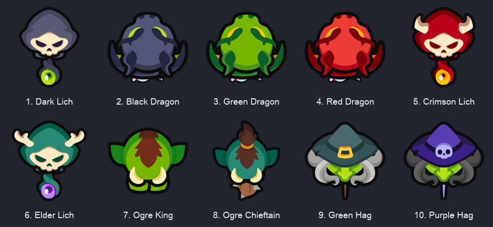
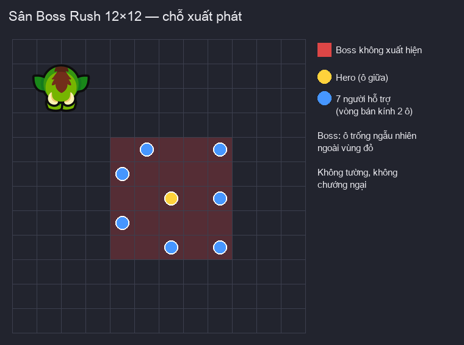
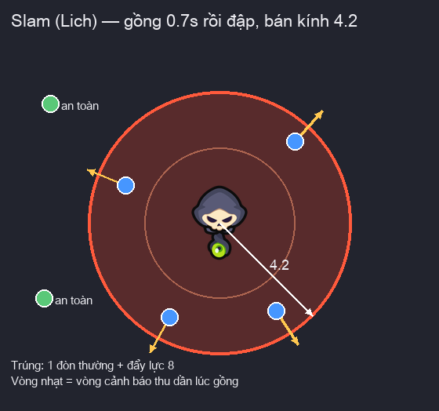
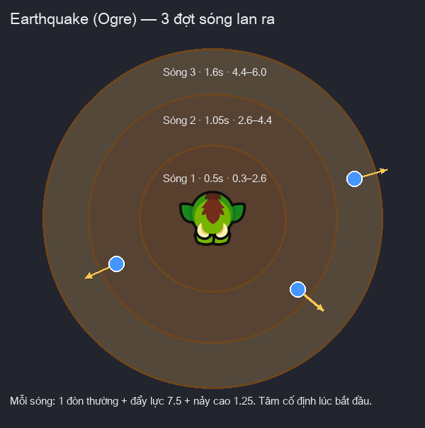
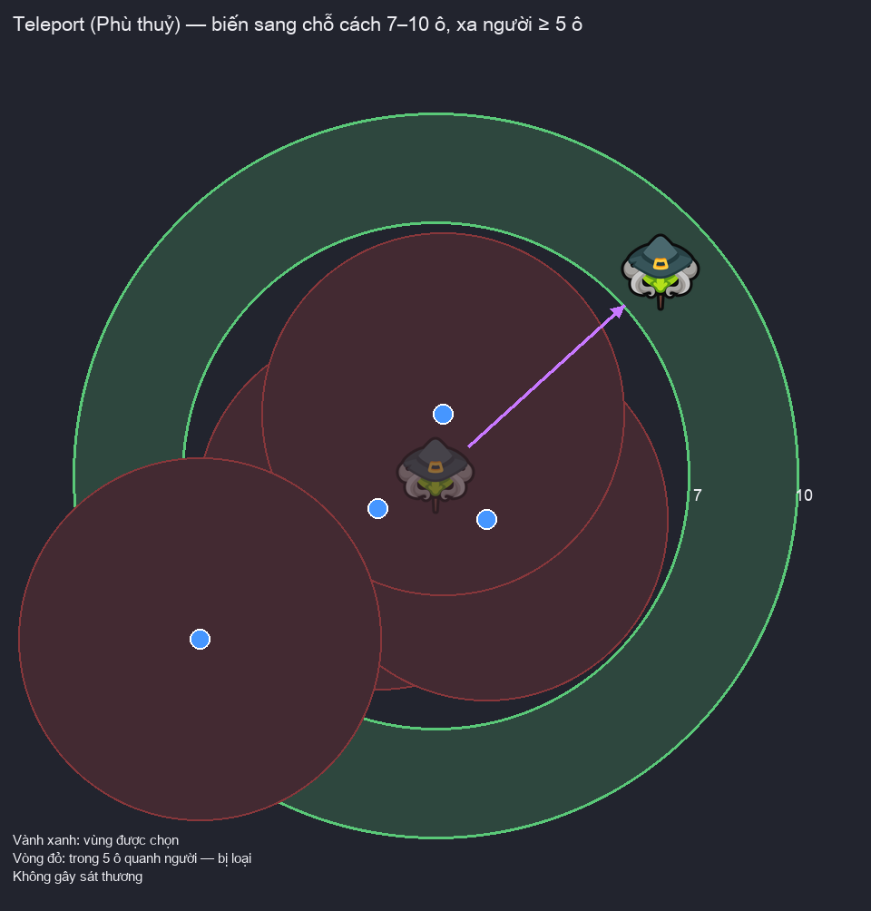
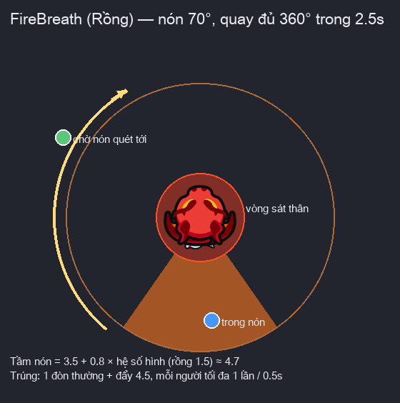
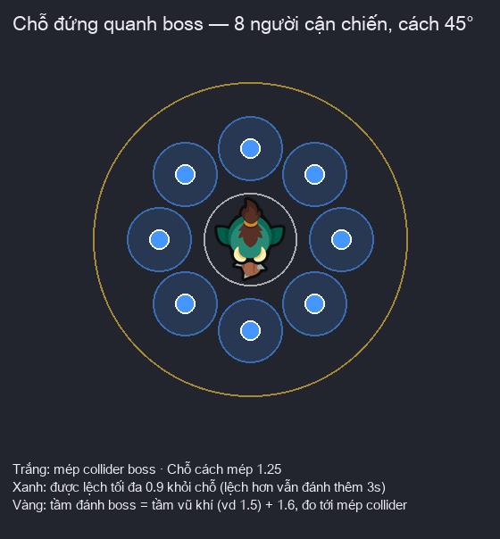

# Boss — Bản thiết kế (GD)

Cập nhật: 2026-10-22 (thêm hình ảnh). Gom mọi boss có trong game: 10 boss Boss Rush, rồng của dungeon Dragon's Hoard và Boss Gate
(gốc tắt). Phần sự kiện Boss Rush (mùa, sảnh, league, thưởng, bot) nằm ở `GDD/BOSS_RUSH_DESIGN.md`; file này chỉ nói về
**con boss**: chỉ số, cách đánh, skill, hình ảnh.
Số liệu reverse: `DecodedData/BOSS_RUSH_MODEL.md` (mục 8–10), `DecodedData/DUNGEON_MODEL.md`,
`DecodedData/ENEMY_STATS_MODEL.md`, `DecodedData/BOSS_BUTTON_MODEL.md`.

Ký hiệu độ chắc chắn của từng mục:

| Ký hiệu | Nghĩa |
|---|---|
| **[GỐC]** | Xác nhận từ game gốc (đọc từ APK hoặc ảnh chụp khi chơi thật) |
| **[CHỐT]** | Đã thống nhất trong thảo luận |
| **[ĐỀ XUẤT]** | Đề xuất, chờ duyệt |
| **[CHỜ SỐ LIỆU]** | Cần ghi thêm từ game gốc mới quyết định được |

---

## 1. Tổng quan

| Nơi gặp | Boss | Có trong game |
|---|---|---|
| Boss Rush (tab Events) | 10 mẫu boss, lặp vòng 20 boss mỗi league | Có |
| Dungeon Dragon's Hoard | 1 con rồng | Có |
| Boss Gate (campaign, màn chia hết 10) | 10 mẫu boss như Boss Rush | Không — gốc tắt |

- Màn campaign thường không có boss, chỉ có lính cận chiến và bắn xa. **[GỐC]**
- Dungeon Zombie Outbreak và Cultist Ritual không có boss, chỉ có quái thường. **[GỐC]**
- Gốc tắt Boss Gate nên project không làm (mục 9). **[CHỐT]**

## 2. Danh sách 10 boss Boss Rush

Boss #N dùng mẫu thứ `(N − 1) % 10 + 1`, nên boss #11 lại là Dark Lich. **[GỐC]**

| Mẫu | Hình | Tên | Họ | Kiểu đánh | Skill |
|---|---|---|---|---|---|
| 1 |  | Dark Lich | Lich | Bắn xa | Slam |
| 2 |  | Black Dragon | Rồng | Bắn xa | FireBreath |
| 3 |  | Green Dragon | Rồng | Bắn xa | FireBreath |
| 4 |  | Red Dragon | Rồng | Bắn xa | FireBreath |
| 5 |  | Crimson Lich | Lich | Bắn xa | Slam |
| 6 |  | Elder Lich | Lich | Bắn xa | Slam |
| 7 |  | Ogre King | Ogre | Cận chiến | Earthquake |
| 8 |  | Ogre Chieftain | Ogre | Cận chiến | Earthquake |
| 9 |  | Green Hag | Phù thuỷ | Bắn xa | Teleport |
| 10 |  | Purple Hag | Phù thuỷ | Bắn xa | Teleport |

**[GỐC]** — bảng `BossDefinitions` của `BossRushConfig` bản v59.

### 2.1 Thân hình

| Tên | Collider × | Hình × | Khối lượng × | Tốc chạy × | Dời chỗ sau (giây) |
|---|---|---|---|---|---|
| Dark Lich | 1.6 | 1.2 | 5 | 1.5 | 1.6 |
| Black Dragon | 1.75 | 1.5 | 5 | 1 | 1.75 |
| Green Dragon | 1.75 | 1.5 | 5 | 1 | 1.6 |
| Red Dragon | 1.75 | 1.5 | 5 | 1 | 1.6 |
| Crimson Lich | 1.6 | 1.2 | 5 | 1.5 | 1.6 |
| Elder Lich | 1.6 | 1.2 | 5 | 1.5 | 1.6 |
| Ogre King | 1.75 | 1.5 | 5 | 1 | 1.6 |
| Ogre Chieftain | 1.75 | 1.5 | 5 | 1 | 1.6 |
| Green Hag | 1.5 | 1.1 | 5 | 1.5 | 1.6 |
| Purple Hag | 1.5 | 1.1 | 5 | 1.5 | 1.6 |

**[GỐC]**

- Cả 10 boss đều đi lại được (bản v41 cũ đứng yên, v59 đổi). **[GỐC]**
- Bán kính tìm chỗ mới khi dời chỗ: 3.5 ô, chung cả 10 boss. **[GỐC]**
- Collider, hình, khối lượng và tốc chạy là hệ số nhân trên giá trị nền của quái. **[GỐC]**

### 2.2 Vũ khí

| Tên | Tầm đánh | Đòn / giây | Tốc đạn | Đạn |
|---|---|---|---|---|
| Dark Lich | 100 | 1 | 12 | Cầu tím |
| Black Dragon | 100 | 1 | 12 | Cầu lửa tím |
| Green Dragon | 100 | 1 | 12 | Cầu lửa xanh |
| Red Dragon | 100 | 1 | 12 | Cầu lửa đỏ |
| Crimson Lich | 100 | 1 | 12 | Cầu đỏ |
| Elder Lich | 100 | 1 | 12 | Cầu xanh |
| Ogre King | 3 | 1 | — | Cận chiến |
| Ogre Chieftain | 3 | 1 | — | Cận chiến |
| Green Hag | 100 | 1 | 12 | Cầu xanh |
| Purple Hag | 100 | 1 | 12 | Cầu xanh |

**[GỐC]**

- Tầm 100 = bắn tới mọi chỗ trên sân. **[GỐC]**
- Đạn bay thẳng, có thể trượt nếu mục tiêu chạy khỏi đường bay. **[GỐC]**

## 3. Chỉ số Boss Rush

### 3.1 Máu

- Máu boss do **league** và **số thứ tự boss** quyết định, không phụ thuộc mẫu boss. **[GỐC]**
- Mỗi league có 20 boss; boss sau trâu hơn boss trước khoảng 1.5 lần. **[GỐC]**
- Máu là máu chung của cả sảnh, lưu ở server. **[GỐC]**

| League | Boss #1 | Boss #10 | Boss #20 |
|---|---|---|---|
| Iron | 500M | 19B | 1.108T |
| Bronze | 1B | 38B | 2.217T |
| Silver | 2B | 77B | 4.434T |
| Gold | 3B | 115B | 6.651T |
| Platinum | 5B | 192B | 11.084T |
| Emerald | 10B | 384B | 22.168T |
| Diamond | 20B | 769B | 44.337T |
| Master | 30B | 1.153T | 66.505T |
| Grandmaster | 50B | 1.922T | 110.842T |
| Legend | 100B | 3.844T | 221.684T |

**[GỐC]** — bảng đủ 20 boss: `DecodedData/BOSS_RUSH_MODEL.md` mục 3.

### 3.2 Sát thương

- Mỗi đòn của boss gây đúng số sát thương của league, không theo số thứ tự boss. **[GỐC]**
- Đòn skill gây sát thương bằng 1 đòn thường lên từng người trúng. **[GỐC]**

| League | Sát thương mỗi đòn |
|---|---|
| Iron | 300 |
| Bronze | 600 |
| Silver | 900 |
| Gold | 3000 |
| Platinum | 6000 |
| Emerald | 9000 |
| Diamond | 12000 |
| Master | 15000 |
| Grandmaster | 18000 |
| Legend | 21000 |

**[GỐC]**

## 4. Hành vi chung trong trận Boss Rush

### 4.1 Xuất hiện

- Sân 12×12, không tường, không chướng ngại. **[GỐC]**
- Boss xuất hiện ở ô trống ngẫu nhiên, tránh vùng 5×5 giữa sân nơi đội đứng. **[GỐC]**
- Đội xuất phát: hero ở ô giữa, 7 người hỗ trợ rải đều trên vòng bán kính 2 ô quanh hero. **[GỐC]**

### 4.2 Vòng hành động

Mỗi lần boss rảnh tay, xét theo thứ tự: **[GỐC]**

1. Tới giờ skill → dùng skill (mục 5).
2. Tới giờ dời chỗ → chạy sang ô mới.
3. Còn lại → đánh thường mục tiêu.

### 4.3 Skill

- Skill đầu tiên hẹn ngẫu nhiên sau 4–6 giây; xong một skill lại hẹn 4–6 giây cho lần sau. **[GỐC]**
- Đang dùng skill thì boss đứng yên, không bị đẩy, không đánh thường. **[GỐC]**

### 4.4 Dời chỗ

- Đòn thường của boss trúng người → hẹn dời chỗ sau thời gian "Dời chỗ sau" của boss (mục 2.1). **[GỐC]**
- Đã có hẹn thì đòn trúng sau không dời hẹn, nên boss dời chỗ đều đặn khoảng 1.6 giây một lần khi đang đánh trúng. **[GỐC]**
- Ô mới: ô trống, đi được, cách ô hiện tại tối đa 3.5 ô; ưu tiên ô cách ít nhất 2.5 ô. **[GỐC]**

### 4.5 Va chạm

- Boss đánh trúng người đội nhà → người đó bị đẩy lùi lực 3. **[GỐC]**
- Boss bị chí mạng → hình nảy to 8% trong 0.18 giây, cách nhau ít nhất 0.35 giây. **[GỐC]**
- Sân không tường nên skill có thể hất người ra ngoài lưới. **[GỐC]**

### 4.6 Boss chết

- Boss chết giữa trận → hiện thông báo "Boss Defeated", boss kế xuất hiện ngay ở ô ngẫu nhiên mới. **[GỐC]**
- Boss kế mang máu đầy theo bảng mục 3.1. **[GỐC]**

## 5. Skill

### 5.1 Slam — họ Lich

Đập xuống đất quanh mình, hất văng mọi người đứng gần. **[GỐC]**

1. Gồng 0.7 giây: vòng đỏ cảnh báo thu nhỏ dần từ 2 lần bán kính về cỡ thân boss.
2. Hết gồng: mọi người cách boss ≤ 4.2 bị 1 đòn và bị đẩy lực 8.
3. Nổ chớp sáng + vành lửa loang ra, rung camera.
4. Hồi 0.4 giây rồi về vòng hành động.

| Thông số | Giá trị |
|---|---|
| Gồng (giây) | 0.7 |
| Hồi (giây) | 0.4 |
| Bán kính | 4.2 |
| Lực đẩy | 8 |
| Tổng thời gian (giây) | 1.1 |

### 5.2 Earthquake — họ Ogre

Giậm đất tạo 3 đợt sóng lan dần ra ngoài. Đứng xa hơn vẫn có thể dính đợt sau. **[GỐC]**

1. Gồng 0.5 giây.
2. Sóng 1 nổ: vành từ 0.3 tới 2.6.
3. Sau 0.55 giây sóng 2 nổ: vành từ 2.6 tới 4.4.
4. Sau 0.55 giây sóng 3 nổ: vành từ 4.4 tới 6.0.
5. Mỗi sóng: người trong vành bị 1 đòn, bị đẩy lực 7.5 và nảy hình lên cao 1.25.
6. Hồi 0.4 giây rồi về vòng hành động.

| Thông số | Giá trị |
|---|---|
| Gồng (giây) | 0.5 |
| Cách giữa 2 sóng (giây) | 0.55 |
| Bán kính sóng 1 | 2.6 |
| Bán kính sóng 2 | 4.4 |
| Bán kính sóng 3 | 6.0 |
| Lực đẩy | 7.5 |
| Độ nảy | 1.25 |
| Tổng thời gian (giây) | 2.0 |

- Tâm sóng cố định ở chỗ boss lúc bắt đầu skill. **[GỐC]**
- Đứng sát boss (trong 0.3) không bị sóng 1. **[GỐC]**

### 5.3 Teleport — họ Phù thuỷ

Biến mất rồi hiện ra ở chỗ xa đội, buộc đội cận chiến phải chạy theo. **[GỐC]**

1. Gồng 0.35 giây: chớp tím tại chỗ, hình thu nhỏ lại.
2. Dịch chuyển sang ô đích, chớp tím ở cả chỗ cũ và chỗ mới.
3. Quay mặt về người gần nhất, hình phóng to lại.
4. Hồi 0.25 giây rồi về vòng hành động.

| Thông số | Giá trị |
|---|---|
| Gồng (giây) | 0.35 |
| Hồi (giây) | 0.25 |
| Khoảng cách tối thiểu (ô) | 7 |
| Khoảng cách tối đa (ô) | 10 |
| Cách người gần nhất tối thiểu (ô) | 5 |
| Tổng thời gian (giây) | 0.6 |

- Ô đích: ô trống, đi được, cách boss 7–10 ô và cách người gần nhất ít nhất 5 ô; chọn ngẫu nhiên. **[GỐC]**
- Không có ô nào đủ điều kiện → chọn ô xa người nhất. **[GỐC]**
- Skill này **không gây sát thương**. **[GỐC]**

### 5.4 FireBreath — họ Rồng

Phun lửa hình nón, quay một vòng tròn quanh mình. **[GỐC]**

1. Gồng 0.4 giây, bỏ mục tiêu đang đánh.
2. Quét 360° trong 2.5 giây, bắt đầu từ hướng đang nhìn; thân rồng xoay theo.
3. Người trong nón bị 1 đòn và bị đẩy lực 4.5; mỗi người tối đa 1 lần mỗi 0.5 giây.
4. Hồi 0.3 giây, nhận lại mục tiêu cũ, về vòng hành động.

| Thông số | Giá trị |
|---|---|
| Gồng (giây) | 0.4 |
| Thời gian quét (giây) | 2.5 |
| Hồi (giây) | 0.3 |
| Góc nón (độ) | 70 |
| Tầm nón | 3.5 |
| Lệch miệng | 0.8 |
| Cách giữa 2 lần trúng (giây) | 0.5 |
| Lực đẩy | 4.5 |
| Tổng thời gian (giây) | 3.2 |

- Tầm nón tính từ miệng rồng: 3.5 + 0.8 × hệ số hình. **[GỐC]**
- Đứng sát thân rồng (trong nửa cỡ thân + 0.8) luôn bị trúng, kể cả ngoài nón. **[GỐC]**
- Hệ quả: đứng ngoài vòng sát thân thường chỉ dính 1 lần mỗi vòng quét; đứng sát thân có thể dính tới 5 lần. **[ĐỀ XUẤT]**

## 6. Chỗ đứng quanh boss

Áp dụng cho người đội nhà **đánh cận chiến**; người bắn xa đứng đánh như bình thường. **[GỐC]**

- Quanh boss chia đều số chỗ bằng số người trong đội (8 người → 8 chỗ, cách nhau 45°). **[GỐC]**
- Mỗi chỗ cách mép collider boss 1.25. **[GỐC]**
- Người đã có chỗ giữ nguyên chỗ; người mới lấy chỗ trống có góc gần hướng mình tới nhất. **[GỐC]**
- Đánh được boss khi khoảng cách tới mép collider ≤ tầm vũ khí + 1.6 và đứng cách chỗ của mình ≤ 0.9. **[GỐC]**
- Bị đẩy lệch chỗ vẫn được đánh thêm 3 giây. **[GỐC]**
- Chỗ đứng đi theo boss: boss dời chỗ hay teleport thì cả vòng dời theo. **[GỐC]**

## 7. Rồng Dragon's Hoard

### 7.1 Trận đánh

- Mỗi màn đúng **1 con rồng**, không có quái khác. **[GỐC]**
- Rồng đứng ở hàng thứ 3 từ trên xuống, giữa sân, quay mặt xuống dưới. **[GỐC]**
- Rồng đứng yên suốt trận, không dời chỗ, không có skill. **[GỐC]**
- Bắn cầu lửa 1 phát/giây, tầm 100 (cả sân), đạn tốc 12. **[GỐC]**
- Collider × 1.1. **[GỐC]**
- Giết rồng là thắng màn; hero chết là thua. **[GỐC]**
- Không có đồng hồ giới hạn thời gian; code gốc không thấy bộ đếm riêng cho dungeon. **[GỐC]**

### 7.2 Chỉ số

Rồng dùng đúng công thức chỉ số quái dungeon, vai trò **bắn xa** (không phải vai trò boss). **[GỐC]**

1. Cấp chiến đấu = 1 + (level dungeon − 1) × 3.
2. Tổng sức mạnh = 500 × 10^h, h tính theo cấp chiến đấu (bảng phân đoạn ở `ENEMY_STATS_MODEL.md` mục 2).
3. Máu = √(sức mạnh × 2), sát thương = √(sức mạnh / 2) × 0.8.

| Level dungeon | Hiển thị | Sát thương | Máu |
|---|---|---|---|
| 1 | 1-1 | 13 | 33 |
| 5 | 1-5 | 27 | 67 |
| 10 | 1-10 | 63 | 158 |
| 20 | 2-10 | 357 | 891 |
| 50 | 5-10 | 17195 | 42987 |

**[GỐC]**

### 7.3 Thưởng

- Thắng → tiêu 1 key, nhận Hammer = 50 + (level − 1), lên level kế. **[GỐC]**
- Thua hoặc thoát → không tiêu key, giữ level. **[GỐC]**
- Rồng không rơi mảnh exp, không cho exp người chơi. **[GỐC]**
- Luật key, quảng cáo, Sweep: `DecodedData/DUNGEON_MODEL.md`.

## 8. Hình ảnh

| Boss | Prefab trong project | Animator | Mũ / găng / vũ khí |
|---|---|---|---|
| Dark Lich | `BossRushDarkLich` | Lich | lych_01 |
| Black Dragon | `BossRushBlackDragon` | Dragon | Purple Dragon |
| Green Dragon | `BossRushGreenDragon` | Dragon | Green Dragon |
| Red Dragon | `BossRushRedDragon` | Dragon | Red Dragon |
| Crimson Lich | `BossRushCrimsonLich` | Lich | lych_02 |
| Elder Lich | `BossRushElderLich` | Lich | lych_03 |
| Ogre King | `BossRushOgreKing` | Ogre | ogre_01 |
| Ogre Chieftain | `BossRushOgreChieftain` | Ogre2 | ogre_02 |
| Green Hag | `BossRushGreenHag` | Witch | witch_01 |
| Purple Hag | `BossRushPurpleHag` | Witch | witch_02 |
| Rồng dungeon | `DragonDungeonMode.enemyPrefab` | Dragon | Dragon (bộ thường) |

- Prefab boss Boss Rush nằm ở `Prefabs/Units/Enemies/BossRush/`; sprite ở `Art/4_Characters/Enemies/` giữ tên gốc. **[GỐC]**
- Ogre King không cầm vũ khí, đánh tay không. **[GỐC]**
- Purple Hag dùng găng của Green Hag. **[GỐC]**
- Sảnh Boss Rush hiện tên boss dạng "Boss #N: Tên"; HUD trong trận hiện tên boss và thanh máu. **[GỐC]**
- Gốc có prefab FX riêng cho Slam (Lich) và FireBreath (rồng); thiếu prefab thì gốc tự vẽ FX mặt đất bằng code. **[GỐC]**

Ảnh boss trong file này render thẳng từ prefab của project (tư thế đứng yên, nhìn từ trên xuống), lưu ở `GDD/img/boss/`.
Sơ đồ sân, skill và chỗ đứng là hình vẽ minh hoạ theo đúng số đo, không phải ảnh chụp trong trận.

## 9. Boss Gate **[GỐC]**

- Thiết kế gốc: màn campaign chia hết 10 là cổng boss, dùng 10 mẫu boss như Boss Rush (bản v41: đứng yên, collider × 1.5, dời chỗ sau 5 giây).
- Thua cổng boss thì bị lùi màn; nút Boss trên thanh trên cho đánh lại.
- Remote config live `boss_gate_enabled = false` → người chơi gốc không bao giờ gặp, nút Boss không bao giờ hiện.
- Project giữ tắt, không làm. **[CHỐT]**
- Chỉ số boss ở cổng (hàm `SpawnController.hvo`) chưa reverse; chỉ cần nếu sau này bật. **[CHỜ SỐ LIỆU]**

## 10. Chưa chốt

### Chờ bạn quyết định

1. FX skill: giữ FX vẽ bằng code như hiện tại, hay trích prefab FX Slam/FireBreath gốc từ v59.
2. Boss có reskin theo đợt reskin toàn game không (quái campaign đã đổi sang vịt đen, boss vẫn hình gốc).
3. Boss Gate: giữ tắt như gốc (đề xuất giữ tắt).

### Chờ số liệu từ game gốc

1. Animation chết của boss (trạng thái `IsDying`) — gốc có, chưa đối chiếu cách dùng.
2. Prefab FX Slam / FireBreath của v59 (vị trí trong xapk, thông số hiệu ứng).
3. Chỉ số boss ở Boss Gate — chỉ khi quyết bật.

## 11. Tình trạng code

### Đã làm

| Hạng mục | Ở đâu |
|---|---|
| Bảng máu, sát thương, 10 mẫu boss v59 | `Scripts/BossRush/StaticBossRushData.cs`, server `config.ts` |
| Boss đi lại, dời chỗ, nảy khi bị chí mạng, Animator đánh | `Scripts/BossRush/BossRushBossUnit.cs` |
| 4 skill Slam / Earthquake / Teleport / FireBreath | `Scripts/BossRush/BossRushSkills.cs` |
| FX skill vẽ bằng code | `Scripts/BossRush/BossRushGroundFX.cs` |
| Chỗ đứng quanh boss cho cận chiến | `Scripts/BossRush/BossRushSlots.cs` |
| Boss chết → boss kế, "Boss Defeated" | `BossRushMode.CheckRemainingEnemies` |
| 10 prefab boss + animation đánh | `Prefabs/Units/Enemies/BossRush/`, `Animations/{Lich,Ogre,Witch}/` |
| Rồng Dragon's Hoard | `GamePlay/Mode/Dungeon/DragonDungeonMode.cs`, `EnemySpawnGenerator.GenerateDragon` |

4 skill đã test Play OK (2026-10-21).

### Chưa làm

| Hạng mục | Ghi chú |
|---|---|
| Animation chết của boss | Boss biến mất sau 1 giây, chưa chạy `IsDying` |
| Prefab FX gốc Slam / FireBreath | Đang dùng FX vẽ bằng code |
| Test Play rồng Dragon's Hoard | Map dungeon chưa test Play |
| Boss Gate | Gốc tắt, không làm |
